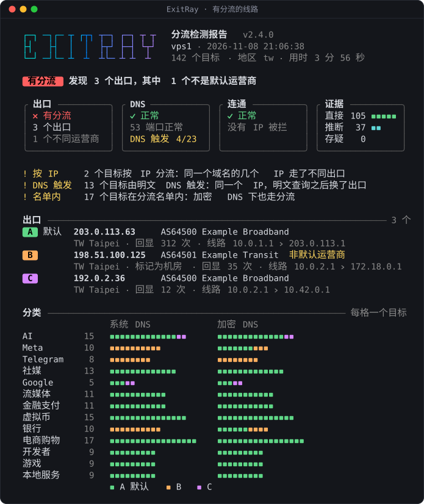

<div align="center">


<p>
<b>VPS / 家宽出口分流检测</b><br>
每个目标实际从哪个 IP 出去、是怎么被分的流，一条命令看清楚
</p>

[](https://github.com/YePiXpert/exitray/actions/workflows/test.yml)

[](LICENSE)

[用法](#用法) · [看报告](#看报告) · [分享结果](#分享结果) · [详细说明](docs/guide.md)

</div>

<p align="center">
  
</p>

同一台 VPS、同一条家宽线路，访问不同网站时出口不一定是同一个：上游可能按名单、按明文 DNS 查询、按 IP 段或 TLS 域名，把一部分目标转去别的出口；也可能不换出口，而是劫持 53 端口、屏蔽域名、拦掉某些 IP 段。

ExitRay 把请求钉到目标的 IP 上，让目标自己报出它看到的访问者 IP，拿不到才用路由推断，每条结果都标明证据。内置 13 个分类、一百多个目标：AI、Meta、Telegram、流媒体、虚拟币等，再加上出口所在地区的银行、电商和本地服务。

## 用法

在要检测的机器上运行，选好检测范围后约 5 分钟出结果：

```bash
bash <(curl -fsSL https://raw.githubusercontent.com/YePiXpert/exitray/main/exitray.sh)
```

2.3.0 以前叫 splitcheck，旧的一键命令还能用，会转去运行新脚本。

常用参数直接加在命令后面：

| 想做什么 | 加上 |
|---|---|
| 不看菜单，直接测全部分类 | `-y` |
| 只测几个分类 | `-c ai,meta,telegram` |
| 赶时间：不测 DNS 触发和 SNI，约 3 分钟 | `-y --no-dns-test --no-sniff` |
| 小内存 VPS：降低并发 | `-L` |
| 检查节点（xray、sing-box）自己的分流 | `-x socks5h://127.0.0.1:1080` |

全部选项见 `--help` 或[详细说明](docs/guide.md#选项)。

需要 bash 4+、curl 和 awk。缺 mtr、dig（加了 `-i` 还有 rsvg-convert 和中文字体）时会用系统的包管理器自动装一次，加 `--no-install` 就不装；除此之外全程只读，不改系统配置。脚本不上传结果，运行时会访问被测网站和几家回显、查询服务，清单见[隐私](docs/guide.md#隐私)。

## 看报告

最上面一句是结论，前面的色块是类别：

| 结论 | 意思 |
|---|---|
| 🔴 **有分流** | 发现了第二个出口 |
| 🟡 **DNS 异常** | 没发现第二个出口，但 53 端口被劫持，或有域名被 DNS 屏蔽 |
| 🟡 **IP 拦截** | 没发现第二个出口，但有目标被按 IP 拦截 |
| 🟡 **证据不足** | 没发现第二个出口，但有目标确认不了出口，不能排除分流 |
| 🟢 **无分流** | 能测的目标都有证据，都走同一个出口 |

下面四张卡片把出口、DNS、连通、证据分开说。分类概览里每格是一个目标，按出口上色；左列是系统 DNS 下的出口，右列是加密 DNS 下的，两列不一样就是和 DNS 有关的分流。每个标记的意思见[详细说明](docs/guide.md#报告怎么读)。

## 分享结果

终端里的报告有完整的出口 IP、主机名和路由，是给自己看的。要发给别人，加下面的参数，IP 只留前两段：

| 参数 | 得到什么 |
|---|---|
| `-i` | 报告照常输出，另存一张概览图片（PNG），手机一屏看得完 |
| `-s` | 十几行文字摘要，适合贴在聊天里 |
| `-m` | 完整的 Markdown 表格，适合贴到论坛 |

要完整 IP 再加 `--no-mask`。示例和细节见[详细说明](docs/guide.md#分享结果)。

## 许可证

[MIT](LICENSE)
