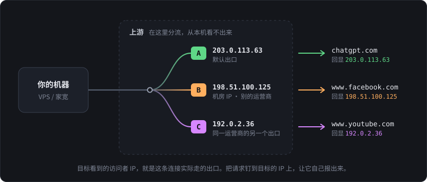
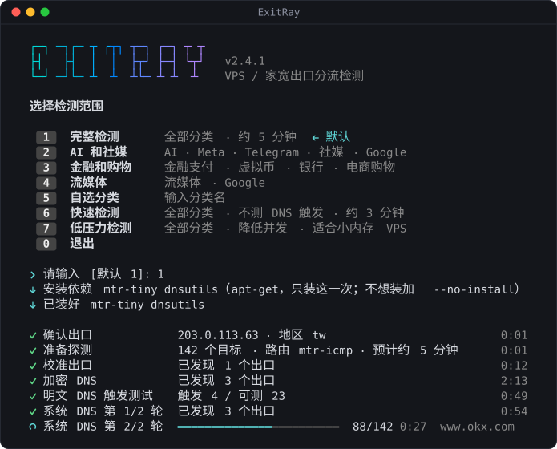
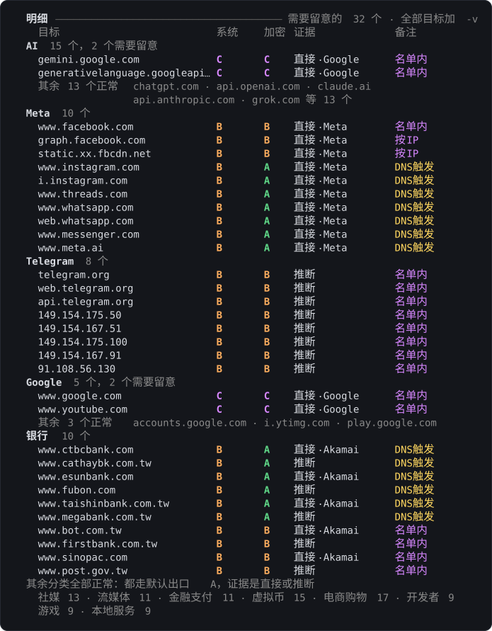
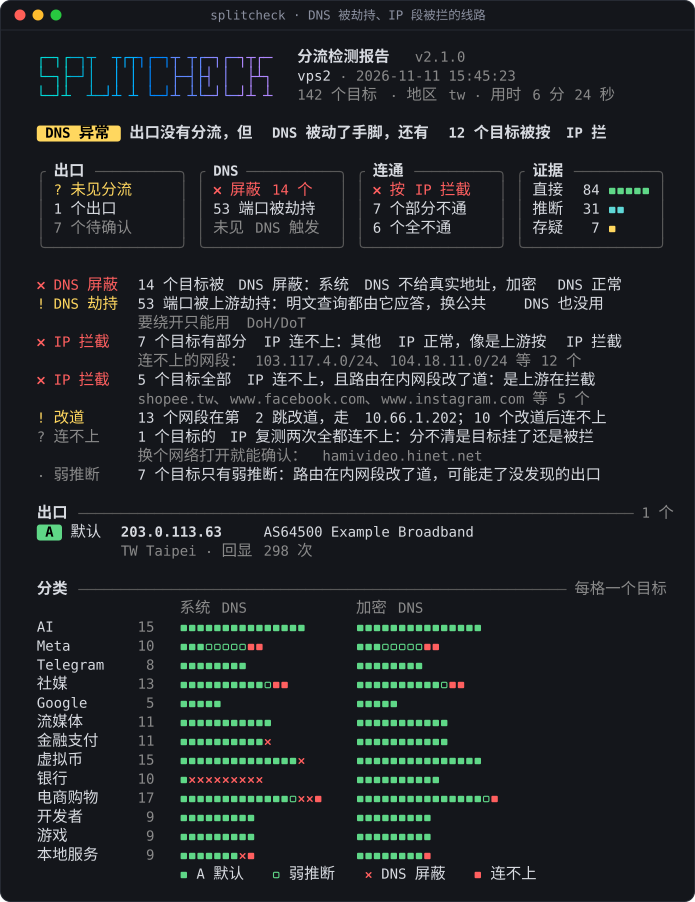
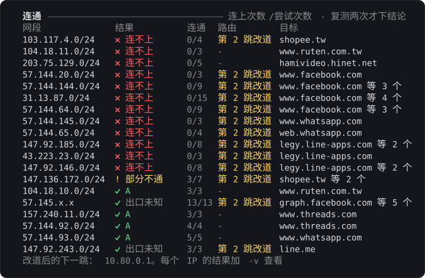

<div align="center">


<p>
<b>VPS / 家宽出口分流检测</b><br>
每个目标实际从哪个 IP 出去、是怎么被分的流，一条命令看清楚
</p>

[](https://github.com/YePiXpert/splitcheck/actions/workflows/test.yml)

[](LICENSE)

[一键运行](#一键运行) · [报告怎么读](#报告怎么读) · [怎么判断的](#怎么判断的) · [选项](#选项) · [局限](#局限) · [隐私](#隐私)

</div>

<p align="center">
  
</p>

同一台 VPS、同一条家宽线路，访问不同网站时出口 IP 不一定是同一个。上游可能把一部分目标转去另一个出口：有的按固定名单分，有的监听明文 DNS，哪个域名被查过，就把它的 IP 写进名单。也有的线路不换出口，而是劫持 53 端口、屏蔽域名，或者把某些 IP 段改道、丢掉。

只比路由首跳的脚本，遇到内网跳多的线路常常只能给出“无法判定”，而实际可能已经分流了。splitcheck 换了个办法：**把请求钉到目标的 IP 上，让目标自己报出它看到的访问者 IP**。拿不到回显才用路由推断，每条结果都标明证据是哪一种。

<p align="center">
  
</p>

## 能看出什么

| 线路上发生了什么 | 报告里叫 | 依据 |
|---|---|---|
| 一部分目标走了别的出口 | 有分流 · 名单内 | 目标回显的访问者 IP 和默认出口不同 |
| 明文查过 DNS 才被分流 | DNS触发 | 同一个 IP，明文查询之后换了出口 |
| 同域名的几个 IP 出口不同 | 按IP | 每个 /24 各测一个 IP |
| 按 TLS 里的域名分流 | 按SNI | 把域名放进 SNI 发给中立的回显服务，出口变了 |
| 53 端口被劫持 | DNS 劫持 | 发给保留地址 `192.0.2.53` 的查询也收到了应答 |
| 域名被解析成 0.0.0.0 | DNS 屏蔽 | 系统 DNS 不给真实地址，加密 DNS 能拿到 |
| 某些 IP 段被改道、被拦 | 改道 · IP 拦截 | 路由在内网段离开了已确认的线路；复测两次仍连不上 |
| 出口在一组 IP 之间轮换 | 出口池 | 同一个中立回显连问几次，出口在变 |
| 机器前面有透明代理 | 透明代理 · fake-ip | 请求被按 Host 转走；系统 DNS 返回 198.18.x.x |

内置 13 个分类、110 多个通用目标：AI、Meta、Telegram、社媒、Google、流媒体、金融支付、虚拟币、电商购物、开发者、游戏。再按出口所在的地区，加上当地的银行、电商和本地服务。

## 一键运行

在要检测的机器上执行。选好范围后，完整检测一般 5 分钟左右。

```bash
bash <(curl -fsSL https://raw.githubusercontent.com/YePiXpert/splitcheck/main/splitcheck.sh)
```

<p align="center">
  
</p>

参数直接跟在命令后面，带了参数就不显示菜单：

```bash
bash <(curl -fsSL https://raw.githubusercontent.com/YePiXpert/splitcheck/main/splitcheck.sh) -y
```

| 想做什么 | 加上 |
|---|---|
| 不看菜单，直接测全部分类 | `-y` |
| 只测几个分类 | `-c ai,meta,telegram` |
| 赶时间：不测 DNS 触发和 SNI，约 3 分钟 | `-y --no-dns-test --no-sniff` |
| 小内存 VPS：降低并发 | `-L` |
| 检查节点（xray、sing-box）自己的分流 | `-x socks5h://127.0.0.1:1080` |
| 发几行摘要给别人 | `-s` |
| 把完整表格贴到论坛 | `-m` |

要反复运行，先把脚本存下来，之后用 `bash splitcheck.sh` 加参数。下文的例子都这么写：

```bash
curl -fsSLO https://raw.githubusercontent.com/YePiXpert/splitcheck/main/splitcheck.sh
```

> [!NOTE]
> 需要 bash 4+、curl 和 awk。探测路由要 mtr（或 traceroute、tracepath），触发测试要 dig。缺了的话，脚本开头会用系统的包管理器装一次（apt、dnf、yum、apk、pacman、zypper，要 root 或免密 sudo）；不想装就加 `--no-install`，对应的检查会跳过。
>
> 除了这一次安装，全程只读：不改系统配置，临时文件放在 mktemp 目录，退出时删除。

## 报告怎么读

最上面那张图是一份有分流的报告。从上往下：

| 部分 | 看什么 |
|---|---|
| **结论** | 一句话，前面的色块是结论的类别 |
| **四张卡片** | 出口、DNS、连通、证据各一张。结论只说最要紧的一条，其余的问题在这里一样看得到 |
| **要点** | 每条一个标签。`✗` 是问题，`!` 要留意，`?` 判断不了，`·` 是补充说明 |
| **出口** | 每个出口一个字母，后面是 IP、运营商、所在地、回显次数和它走的线路 |
| **分类** | 每格一个目标，按出口上色。左列是系统 DNS 下的出口，右列是加密 DNS 下的 |
| **DNS** | 53 端口有没有被劫持、哪些域名被屏蔽、触发测试的结果 |
| **连通** | 按 IP 看有出入的目标：每个网段连上次数/尝试次数、走哪个出口、路由有没有改道 |
| **明细** | 只列需要留意的目标，其余的每个分类折成一行。`-v` 列出全部 |

### 结论

| | 结论 | 含义 | `verdict` | 退出码 |
|:-:|---|---|---|:-:|
| 🔴 | **有分流** | 发现了第二个出口 | `split` | 2 |
| 🟡 | **DNS 异常** | 出口没分流，但 53 端口被劫持，或有域名被 DNS 屏蔽 | `dns_tampered` | 2 |
| 🟡 | **IP 拦截** | 出口没分流，但有目标被按 IP 拦截 | `blocked` | 2 |
| 🟡 | **证据不足** | 没发现第二个出口，但有目标确认不了出口 | `inconclusive` | 3 |
| 🟢 | **无分流** | 能测的目标都有证据，都走同一个出口 | `clean` | 0 |

从上往下取第一条成立的。一条线路可以出口没分流，DNS 却被劫持，同时还有 IP 被拦：结论写最要紧的那条，另外两件事在卡片和要点里。系统 DNS 整个用不了时，只测得了加密 DNS，也算证据不足。

`verdict` 是 JSON 里的字段；退出码要加 `--exit-code` 才按结论给，见[定时检查](#定时检查)。

> [!IMPORTANT]
> 证据不足不等于没有分流。只找到一个出口，但有目标是未知、弱推断或被 fake-ip 挡住时，结论会写“没发现第二个出口，但 N/M 个目标证据不足，不能排除分流”。

### 分类概览

每格一个目标。两列对着看：系统 DNS 和加密 DNS 下出口不一样的格子，就是和 DNS 有关的分流。

| 有颜色时 | 纯文本时 | 含义 |
|---|---|---|
| 实心方块，按出口上色 | 出口字母 `A` `B` | 走这个出口，证据是直接或推断 |
| 空心方块，按出口上色 | 小写字母 `a` | 弱推断 |
| 红色 `×` | `x` | 被 DNS 屏蔽 |
| 红色方块 | `!` | 连不上 |
| 灰色空心方块 | `?` | 未知 |

终端支持 256 色时是图里的配色，只有 8 色时退成基本色。接管道、重定向或加 `--no-color` 时是纯文本，结论的色块换成 `【有分流】`，方块换成出口字母。

<details>
<summary>同一份报告的纯文本版</summary>

```text
  ┌─┐┌─┐┬  ┬┌┬┐┌─┐┬ ┬┌─┐┌─┐┬┌─   分流检测报告  v2.1.0
  └─┐├─┘│  │ │ │  ├─┤├┤ │  ├┴┐   vps1 · 2026-11-08 21:06:38
  └─┘┴  ┴─┘┴ ┴ └─┘┴ ┴└─┘└─┘┴ ┴   142 个目标 · 地区 tw · 用时 3 分 56 秒

  【有分流】 发现 3 个出口，其中 1 个不是默认运营商

  ╭ 出口 ──────────╮ ╭ DNS ───────────╮ ╭ 连通 ──────────╮ ╭ 证据 ──────────╮
  │ ✗ 有分流       │ │ ✓ 正常         │ │ ✓ 正常         │ │ 直接 105 ■■■■■ │
  │ 3 个出口       │ │ 53 端口正常    │ │ 没有 IP 被拦   │ │ 推断  37 ■■    │
  │ 1 个不同运营商 │ │ DNS 触发 4/23  │ │                │ │ 存疑   0       │
  ╰────────────────╯ ╰────────────────╯ ╰────────────────╯ ╰────────────────╯

  ! 按 IP     2 个目标按 IP 分流：同一个域名的几个 IP 走了不同出口
  ! DNS 触发  13 个目标由明文 DNS 触发：同一个 IP，明文查询之后换了出口
  ! 名单内    17 个目标在分流名单内：加密 DNS 下也走分流

  出口 ────────────────────────────────────────────────────────────────── 3 个
  [A] 默认  203.0.113.63     AS64500 Example Broadband
            TW Taipei · 回显 312 次 · 线路 10.0.1.1 › 203.0.113.1
  [B]       198.51.100.125   AS64501 Example Transit  非默认运营商
            TW Taipei · 标记为机房 · 回显 35 次 · 线路 10.0.2.1 › 172.18.0.1
  [C]       192.0.2.36       AS64500 Example Broadband
            TW Taipei · 回显 12 次 · 线路 10.0.2.1 › 10.42.0.1

  分类 ────────────────────────────────────────────────────────── 每格一个目标
                   系统 DNS             加密 DNS
  AI          15   AAAAAAAAAAAAACC      AAAAAAAAAAAAACC
  Meta        10   BBBBBBBBBB           AAAAAAAAAB
  Telegram     8   BBBBBBBB             BBBBBBBB
  社媒        13   AAAAAAAAAAAAA        AAAAAAAAAAAAA
  Google       5   AAACC                AAACC
  流媒体      11   AAAAAAAAAAA          AAAAAAAAAAA
  金融支付    11   AAAAAAAAAAA          AAAAAAAAAAA
  虚拟币      15   AAAAAAAAAAAAAAA      AAAAAAAAAAAAAAA
  银行        10   BBBBBBBBBB           AAAAAABBBB
  电商购物    17   AAAAAAAAAAAAAAAAA    AAAAAAAAAAAAAAAAA
  开发者       9   AAAAAAAAA            AAAAAAAAA
  游戏         9   AAAAAAAAA            AAAAAAAAA
  本地服务     9   AAAAAAAAA            AAAAAAAAA
                   A 默认   B   C

  DNS ───────────────────────────────────────────────────── 系统解析器 8.8.8.8
  53 端口    ✓ 未发现劫持
  DNS 屏蔽   ✓ 系统 DNS 和加密 DNS 都能解析
  触发测试   ! 触发 4 / 可测 23：明文查询之后出口变了，上游按 DNS 应答写名单
               www.facebook.com               57.144.248.1    A → B
               accounts.google.com            192.178.226.84  A → C
               www.instagram.com              57.144.248.9    A → B
               graph.facebook.com             57.144.248.3    A → B
               另有 10 个测不了：10 个拿不到回显
```

</details>

### 明细

<p align="center">
  
</p>

- **系统、加密**两列是这个目标在系统 DNS 和加密 DNS 下走的出口。字母后面带 `?` 是弱推断，`1/2` 是两轮系统 DNS 里只有一轮走这个出口，`× 屏蔽` 是被 DNS 屏蔽，`! 不通` 是连不上。
- **证据**是这个出口怎么确认的。
- **备注**是分流方式，以及连通和路由上的问题。

**证据**

| 标记 | 含义 |
|---|---|
| 直接 | 目标自己，或同一个 IP 上的 CDN，回显了访问者 IP。`·` 后面是谁回显的 |
| 推断 | 目标不回显，但路由和已确认出口的线路相同 |
| 弱推断 | 路由在内网段就离开了已确认的线路（改道），出口可能不是默认的那个 |
| 不确定 | 路由同时对得上几条线路，判断不了 |
| 未知 | 既没有回显，也没有路由信息 |

**分流方式**

- **DNS触发**：同一个 IP，用加密 DNS 解析时走默认出口，明文查询之后走分流。这是确凿的：上游按 DNS 应答把它写进了名单。
- **DNS相关**：系统 DNS 解析到的 IP 走分流，加密 DNS 解析到的是别的 IP、走默认出口。分不清是明文查询触发的，还是那个 IP 本来就在名单里，要看触发测试。
- **名单内**：加密 DNS 下也走分流。可能是静态名单，也可能是这个 IP 已经被别的明文查询写了进去。
- **按IP**：同一个域名解析出的几个 IP，各自稳定地走不同出口，规则是按 IP 段写的。
- **按SNI**：把这个域名放进 SNI 发给中立的回显服务，出口就变了，路径上有设备按 TLS 域名分流。真实访问时带的就是这个 SNI，所以这个目标按 SNI 看到的出口算，证据写“直接·SNI”。
- **SNI→B**：换了 SNI 看到的出口是 B，但目标自己的页面给了别的证据。页面的请求本来就带着它的 SNI，以页面的为准。
- **解析不同**：系统 DNS 下走默认出口，加密 DNS 下反而走分流，通常是两边解析到的 IP 不同。

**连通和路由**

| 标记 | 含义 |
|---|---|
| 部分不通 | 同一个域名有的 IP 连得上，有的复测两次都连不上，像是按 IP 拦截 |
| IP不通 | 测到的 IP 都连不上，出口只能按路由推断 |
| 改道 | 这个目标有 IP 的路由在内网段就离开了已确认的线路 |
| TLS不通 | TCP 连得上，TLS 握手不成 |
| 不稳定 | 有 IP 时通时断 |

## 不换出口，也能动手脚

有的线路只有一个出口，问题出在别处。下面是台湾一条家宽线路的报告：出口没有分流，但 53 端口被劫持，14 个域名被 DNS 屏蔽，Meta、LINE、虾皮的一些网段被上游改了道，连不上。

<p align="center">
  
</p>

### DNS

- **53 端口劫持**：向保留地址 `192.0.2.53` 发一个 DNS 查询。这个地址没有 DNS 服务，能收到应答，就说明查询在半路被拦下了。这时换公共 DNS 也没用，要绕开只能用 DoH/DoT。
- **DNS 屏蔽**：系统 DNS 把域名解析成 0.0.0.0、内网地址，或者干脆查不到，加密 DNS 却能拿到真实地址。
- **系统 DNS 用不了**：系统 DNS 对八成以上的域名都不给地址，是解析器本身坏了，不算有选择的屏蔽，结论按证据不足处理。
- **fake-ip**：系统 DNS 返回 198.18.x.x，是 Clash、sing-box 这类透明代理接管了解析。这不是屏蔽，但系统 DNS 这一轮测不到真实出口，算证据不足。要测线路本身先关掉它，要测它的分流用 `-x` 指向它的本地端口。
- **触发测试**：每个分类抽 3 个域名，用 ECS 拿到本机没解析过的外地节点 IP，比较明文查询前后的真实出口。出口变了，就是上游在按 DNS 应答写名单。测不了的会写明原因：53 端口被劫持时，明文应答是劫持方按自己的位置给的，里面没有那个外地 IP，这一项就测不了。

### 连通

<p align="center">
  
</p>

连通分三层看，不混在一起：

| 状态 | 含义 |
|---|---|
| 连不上 | TCP 都连不上，而且再连两次还是不通。一次超时不算 |
| 时通时断 | 连上过，但多数时候连不上 |
| TLS 不通 | TCP 连得上，握手却不成：可能是按 SNI 拦截，也可能是目标自己拒绝。不算按 IP 拦截 |
| 连得上 | 收到了响应，或者 TCP 连上了 |

- 证书不被信任不算连不上。Signal 用自签 CA，不少站点证书链不全，校验不过不代表被拦。
- 表里的“连通”是连上次数/尝试次数。每一轮每个 IP 都会连一次，没试过的不会被当成连得上。
- 同一个目标有 IP 连不上时，它其余的 IP 也再连两次，免得把碰巧连上的一次当成正常。

### 改道

已确认的线路，也就是拿到回显的那些路径，在内网段走哪几跳是知道的。某个 IP 的路径在前几跳就拐去了一个没在这些线路上出现过的内网地址，说明上游对这个 IP 做了手脚。按连通分三种情况：

- **改了道，还连得上，但拿不到回显**：出口未知，算弱推断。可能走了没发现的出口。
- **改了道，连不上**：是上游在拦截，不是目标自己挂了。即使这个目标所有 IP 都连不上，也算按 IP 拦截。
- **没改道，全部 IP 都连不上**：从一个地方分不清是目标挂了还是被拦，只列出来，不影响结论。换个网络打开就能确认。

内网有多路径的线路，同一位置会轮流看到几台路由器。只要那一跳在任何一条已确认的路径上出现过，就不算改道。

### 为什么一个域名要测几个 IP

按 IP 段写的规则，换个解析器就可能落在规则外。Google DoH 带上台湾的 ECS，`www.facebook.com` 解析到 31.13.x.x 的旧网段；运营商 DNS 给的却可能是 57.144.x.x 的新网段。只测一个 IP，结论就看运气。

所以加密 DNS 那一轮把 Google（带出口所在网段的 ECS）和 Cloudflare 的应答合起来，每个 /24 测一个 IP，最多 3 个；系统 DNS 每轮测一个网段，几轮下来轮换。每个 IP 都记下走哪个出口、连不连得上、路由有没有改道。

## 两种容易看错的情况

下面两种情况都不是线路在按目标分流，读数却会像分流。脚本会先把它们认出来。

### 出口池

同一个目标连问几次，出口在几个 IP 之间换，是出口池或多线负载均衡在轮换，不是按目标分流。不认出来的话，轮换会被读成“DNS 触发”或者“按 IP 分流”。

- 校准时把同一个中立回显连问几次，结束时再问几次，发现在换就多问几次。
- 出口不止一个、每个又都出现过至少两次，这些 IP 就合成一个默认出口，报告里列出池里有哪些 IP。
- 只冒出来一次的不算在池里：那可能是偶发的读数，也可能正是别的目标的分流出口。池外的出口照常算分流。
- 检测期间出口 IP 换了（重拨），也按同样的方式处理。

### 透明代理

钉 IP 的探测靠的是“连哪个 IP 就到哪个 IP”。机器前面如果有透明代理按域名改写目的地，测到的就是代理规则的分流，不是线路本身的。

- **按 HTTP 的 Host 改写**：脚本开始时自检，给 1.1.1.1 发一个 Host 是 Akamai 回显的请求。正常只会得到 Cloudflare 的报错页，收到了 IP 就说明请求半路被转去了别处。这时报告顶部会提示，并停用靠 Host 认 CDN 和取回显的办法。
- **按 SNI 改写**：由结尾的 SNI 嗅探发现。
- 要测线路本身，先关掉透明代理；要测它的分流，用 `-x` 指向它的本地端口。

## 分享结果

终端里的报告是给自己看的，里面有完整的出口 IP、主机名和路由。要发给别人，换成下面两种输出：IP 只保留前两段，不带主机名和路由。它们和文字报告是同一次检测的不同输出，要哪种就加哪个参数。

加 `-s` 输出十几行摘要，适合贴在聊天里：

```bash
bash splitcheck.sh -s
```

```text
splitcheck 分流检测 · 2026-11-08 · 地区 tw · 142 个目标
结论：有分流，3 个出口，其中 1 个不是默认运营商
逐 IP：2 个目标按 IP 分流
A 默认  203.0.*.*  AS64500 Example Broadband  TW
B  198.51.*.*  AS64501 Example Transit  TW  标记为机房
C  192.0.*.*  AS64500 Example Broadband  TW
AI：A 13 · C 2
Meta：B 10
Telegram：B 8
社媒：A 13
Google：A 3 · C 2
流媒体：A 11
金融支付：A 11
虚拟币：A 15
银行：B 10
电商购物：A 17
开发者：A 9
游戏：A 9
本地服务：A 9
明文 DNS 触发：是（触发 4 / 可测 23）
证据：直接 105 · 推断 37 · 未确认 0
https://github.com/YePiXpert/splitcheck
```

加 `-m` 输出完整的 Markdown 表格，适合贴到论坛：

```bash
bash splitcheck.sh -m > report.md
```

带颜色的报告要存下来或翻页看，加 `--color`：

```bash
bash splitcheck.sh -y --color | less -R
```

> [!WARNING]
> `-s` 和 `-m` 默认打码，要完整 IP 得加 `--no-mask`。终端里的完整报告没有打码，截图或复制出去之前留意这一点。

## 怎么判断的

<p align="center">
  
</p>

1. **确认出口**：向中立的回显服务问本机的出口 IP，这就是默认出口。顺带自检有没有透明代理在改写连接。
2. **校准线路**：对会回显的服务一边取回显、一边探测路由，记下每条线路对应哪个出口。再把同一个中立回显连问几次，看出口稳不稳定。
3. **加密 DNS 轮**：全部目标用 DoH 解析后测一轮。到这一步为止不发任何明文 DNS，看到的是不靠 DNS 触发的规则。
4. **触发测试**：对外地节点的 IP 先取一次出口，发一次明文查询，再取一次。出口没变会隔一秒多再看一次，免得漏掉写得慢的名单。这一步不受之前运行的影响。
5. **系统 DNS 轮**：用系统解析器再测，默认两轮。同一个 IP 前后两种解析方式出口不同，就是 DNS 触发的分流。
6. **SNI 嗅探**：每个分类抽两个域名，放进 SNI 发给中立的回显服务。回显服务不看 SNI，所以出口变了，或者回来的不是它的应答，都说明上游在按 TLS 域名处理流量。抽样里有出口变了的，其余的域名也都问一遍。没拿到回显的会重试一次，完全连不上的不下结论。
7. **复测**：只出现过一次的读数不直接算数。只回显过一次的非默认出口，把当初那次探测原样再做两遍：出口再出现就算数；看到的成了别的出口，按偶发处理，不算进结论，报告里单独提一句；拿不到回显的，保留并注明没能确认。一次连不上的 IP 再连两次，只看 TCP：都不通才算连不上。
8. **报告**：结束前再问几次中立回显，检测期间出口换了要能看出来；然后查每个出口的运营商和所在地。

每个目标的出口按下面的顺序取证，前一种拿不到才用后一种：

- **回显**：把请求钉到目标解析出的 IP 上，让那个 IP 报出访问者 IP。

  | 服务 | 回显方式 |
  |---|---|
  | Cloudflare | `/cdn-cgi/trace` |
  | Akamai | `Host: whatismyip.akamai.com` |
  | Fastly | `Host: www.fastly-debug.com` |
  | CloudFront | 经同一节点请求一个会显示 IP 的页面 |
  | Google | YouTube 页面的 `remoteHost` |
  | Meta | `facebook.com/diagnostics` |

- **页面**：没有回显就翻首页，页面或响应头里出现了已知出口也算。收到响应头就算连上了，证书不校验。后面几轮只翻第一轮证明有用的页面，其余的 IP 仍然各连一次；IP 目标看 443 端口能不能建立连接。
- **路由**：Telegram、多数银行这类不回显的目标，用路由匹配已校准的线路。路径在内网段拐去了没见过的地址，只算弱推断。

## 检查节点本身

在 VPS 上跑，测的是上游这一层。xray、sing-box 可能另有路由规则，比如把 Google 转给另一台机器。这一层要经节点测：

```bash
bash splitcheck.sh -x socks5h://127.0.0.1:1080 -c ai,meta
```

- 经代理时没有路由信息，不回显的目标会显示未知。
- SOCKS 代理下照样做 SNI 嗅探。节点按域名分流、又不改写目的地时（sing-box 默认如此，xray 要开 `routeOnly`），每个域名走哪个出口都有直接证据；节点会改写目的地时，报告会写“连接被按 TLS 域名转去了别处”。
- HTTP 代理钉不住 IP，SNI 嗅探这一项不测。

## 选项

**测什么**

| 选项 | 作用 |
|---|---|
| `-c`, `--category 列表` | 只测这些分类，逗号分隔。`none` 表示只测 `-a`、`-f` 给的目标 |
| `-r`, `--region 地区` | 用哪个地区的银行、电商和本地服务清单，默认 `auto` |
| `-a`, `--add 分类:域名` | 追加目标，可重复，例如 `-a shop:www.pchome.com.tw` |
| `-f`, `--file 文件` | 从文件读目标，每行“分类 域名” |
| `-y`, `--yes` | 不显示启动菜单，直接测全部分类 |

- 分类：`ai` `meta` `telegram` `social` `google` `stream` `finance` `crypto` `bank` `shop` `dev` `game` `local`
- 地区：`auto` 按出口所在的国家选，也可以指定 `tw` `jp` `hk` `us` `sg` `kr` `vn`，`none` 是不加地区清单

**怎么测**

| 选项 | 作用 |
|---|---|
| `-n`, `--rounds N` | 系统 DNS 测几轮，默认 2 |
| `-p`, `--parallel N` | 并发数，默认 8 |
| `-L`, `--low-resource` | 低压力模式：按 CPU 核数把并发降到 2-4，路由探测降低优先级 |
| `-x`, `--proxy URL` | 经代理测，用来检查节点本身的分流 |
| `--tracer 工具` | 指定路由工具：`mtr-icmp` `mtr-tcp` `traceroute-tcp` `traceroute` `tracepath` |
| `--no-route` | 不探测路由，只看回显。不回显的目标显示未知 |
| `--no-dns-test` | 跳过加密 DNS 轮和明文 DNS 触发测试 |
| `--no-sniff` | 跳过 SNI 嗅探 |
| `--no-install` | 缺 mtr 或 dig 时不自动安装 |

**怎么输出**

| 选项 | 作用 |
|---|---|
| `-b`, `--brief` | 只输出结论、出口、分类概览、DNS 和连通汇总 |
| `-v`, `--verbose` | 明细列出全部目标，外加每一轮和每个 IP 的结果、路径和证据 |
| `-j`, `--json` | 输出 JSON |
| `-m`, `--markdown` | 输出方便分享的 Markdown 报告，IP 默认打码 |
| `-s`, `--summary` | 只输出十几行可直接复制的摘要，IP 默认打码 |
| `--no-mask` | `-s` 和 `-m` 的输出里显示完整 IP |
| `--exit-code` | 用退出码表示结论，方便 cron 和监控 |
| `--color` | 输出不是终端时也用颜色，例如接 `less -R` 或 `tee` |
| `--no-color` | 不用颜色。设了环境变量 `NO_COLOR` 也一样 |
| `-V`, `--version` | 显示版本 |
| `-h`, `--help` | 显示帮助 |

## 定时检查

默认退出码是 0 检测完成、1 运行出错。加 `--exit-code` 后，退出码就是结论：0 无分流，2 有分流、DNS 异常或 IP 拦截，3 证据不足，1 仍然是运行出错。和[结论](#结论)那张表对应。

```bash
bash splitcheck.sh -y -j --exit-code > result.json
```

JSON 里 `split` 只表示有没有发现第二个出口，没发现不等于没有，要看 `verdict`。

<details>
<summary>JSON 里的字段</summary>

- `coverage` 给出各有多少个目标：直接、推断、弱推断、未知、连不上、fake-ip、DNS 屏蔽、按 IP 拦截（`ip_blocked`）、按 IP 分流（`split_by_ip`）、路由改道（`diverted`）和握手不成（`tls_failed`）。
- 每个目标的 `ips` 是逐 IP 的结果：`exit_ids` 是走的出口；`state` 是 `ok`、`flaky`（时通时断）、`tls`（握手不成）、`dead`，没试过是 `null`；`connected` 和 `attempts` 是连上次数和尝试次数；`reachable` 只有 `dead` 时是 `false`；`diverted` 是改道的位置和那一跳的地址，没改道是 `null`。
- 目标的 `reach` 汇总成 `ok`、`partial`、`dead`，`split_by_ip` 表示几个 IP 走了不同出口，`dns_flip` 表示同一个 IP 在明文查询之后换了出口，`sni_exit_id` 是换了 SNI 之后走的出口（没变或没抽到是 `null`）。`sni_test` 里的 `changed` 和 `moved` 是出口变了、连接被转去别处的域名数。
- `exit_pool` 是默认出口为出口池时池里的 IP，它们在 `exits` 里合成了一个。`unstable_exits` 是只出现过一次、复测时没有再出现的出口，不算进 `exits`，也不影响 `verdict`。
- `intercepted` 表示有透明代理改写连接，`system_dns_down` 表示系统 DNS 基本用不了。
- `dns_trigger_test` 里测不了的条目，`untestable` 写明卡在哪一步：`mismatch` 明文应答里没有外地节点的 IP，`noecho` 拿不到回显，`nofar` 查不到外地节点的 IP。

</details>

## 局限

- 明文解析过的 IP 会在上游名单里留一段时间，两次运行建议间隔 15 分钟以上，否则加密 DNS 那一轮可能受上一次影响。
- 复测在系统 DNS 轮之后做，离第一次看到那个出口隔了几十秒到一两分钟。上游名单的保留时间如果比这还短，真实的分流也可能被当成偶发；这种出口会列在报告里，不会悄悄消失。
- 每个 /24 只测一个 IP，一个域名最多测 3 个网段；解析器都没给出的网段测不到。
- 改道只认内网地址：线路在公网地址上分开是正常的路由差异，隧道不回应探测时也看不出来。这两种情况下不回显的目标仍然按推断算。
- 出口池要靠同一个目标连问几次才看得出来。按目标 IP 散列的负载均衡，同一个目标的出口是稳定的，会被看成按 IP 分流；这时几个出口通常属于同一个运营商，线路也相同。
- 没改道、所有 IP 都连不上的目标，从一个地方分不清是目标挂了还是被拦截，只列出来，不影响结论。
- 只测 IPv4。IPv6 只显示有没有，UDP 只看 DNS 查询这一项。
- 回显依赖第三方页面，页面改版后对应目标会退回路由推断。
- Facebook 对部分机房 IP 会把诊断页跳转到登录页，这时 Meta 也只能靠路由推断。
- 地区清单只有 tw、hk、us 在当地实测过，其余只确认过域名能解析。`tracepath` 只用样例输出验证过解析。

## 隐私

脚本不上传结果，也不收集数据。运行时会访问被测网站和下面这些服务，它们能看到本机的出口 IP：

- **DNS**：`dns.google`、`1.1.1.1`、`8.8.8.8` 和 Akamai 的权威 DNS
- **查询出口信息**：`ipinfo.io`、`ip-api.com`（后者只有 HTTP 接口，也是前者限流时的备用来源）
- **回显**：`www.cloudflare.com`、`ifconfig.me`、`checkip.amazonaws.com`、`ident.me`、`ipinfo.tw`、`whatismyip.akamai.com`、`www.fastly-debug.com`、`www.expressvpn.com`、`www.youtube.com`、`www.facebook.com`
- **IPv6 检查**：`api64.ipify.org`

SNI 嗅探会把目标域名放进发给 `ipinfo.io` 的 TLS 握手。代理地址里的账号密码不会写进报告和 JSON。

## 开发

测试不联网，用假的 curl、mtr、dig 跑真实的脚本函数和完整流程。Python 只用于测试，运行脚本不需要：

```bash
python3 tests/test_regression.py
```

只跑一组或一个测试：

```bash
python3 tests/test_regression.py AnalyzeTests
```

- `TEST_AWK=mawk` 或 `TEST_AWK='busybox awk'` 可以换 awk，`TEST_BASH` 可以换 bash。
- CI 在 gawk、mawk、BusyBox awk、bash 4.2 和 Alpine 上各跑一遍。`ubuntu-latest` 是 Ubuntu 26.04，coreutils 默认是 Rust 写的 uutils。
- 测试也能在 Windows 的 Git Bash 下跑：用 `TEST_BASH` 指到 Git 自带的 `usr\bin\bash.exe`（系统里的 `bash.exe` 可能是 WSL 的）。只是起进程慢，完整流程那一组要半个多小时。

改脚本时要留意两件事：

- **并发的探测进程各写各的文件**（`rows.d/进程号`），每一步结束再合并。不要让几个进程追加同一个文件：一行是不是一次写完、写完还动不动文件，取决于 shell 和 coreutils 的实现。uutils 的 `dd` 在 2026 年 10 月以前写完会把文件截到自己写到的位置，并发追加时会截掉别的进程刚写的行。
- **报告的版式定在 78 格以内**，测试会检查每一行的显示宽度。awk 脚本在 C locale 下按字节处理，汉字和全角标点算 2 格，框线和方块算 1 格。改版式时用 `dwidth`、`pad`、`fit` 这几个函数，不要直接数 `length`。
- **README 的配图**由 `docs/tools/build.py` 生成：用示例数据跑脚本里真实的报告和界面函数，把终端输出画成 SVG。改了报告的版式或文案，重新生成一次；它也会核对 README 里的文本样例是不是脚本真会输出的内容。加 `--check` 只检查、不写文件：

  ```bash
  python3 docs/tools/build.py
  ```

## 许可证

[MIT](LICENSE)
